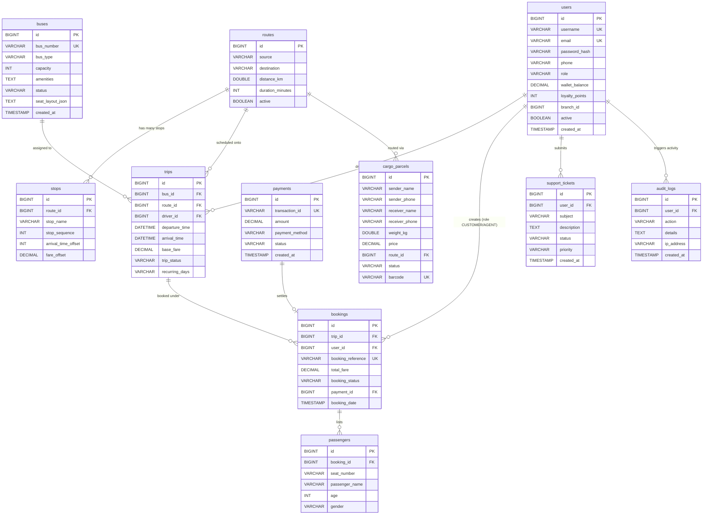

# Entity Relationship Diagram (ERD)

The following diagram illustrates the relational database structure of the Bus Transport Management System. It tracks users, roles, buses, routes, trips, bookings, passenger seat assignments, cargo shipping, support tickets, and payments.

